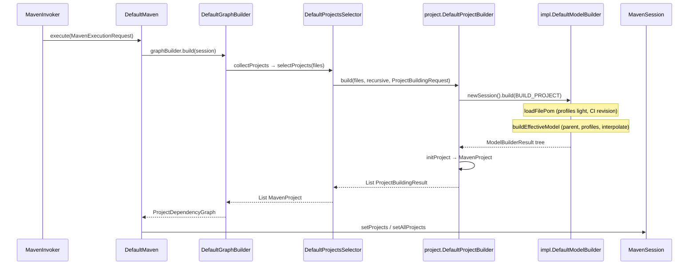

# Research: Przepływ budowania modelu POM (M3↔M4)

**Date**: 2026-10-13T15:24:44+0000  
**Researcher**: Dominik Piber  
**Git Commit**: `3b94a4f31bd4c10a2789b1dced5f58e906c0865c`  
**Branch**: `docs/research-deep-focus`  
**Repository**: apache/maven  

## Research Question

Przeanalizuj przepływ budowania modelu POM w apache/maven (Java), ze szczególnym uwzględnieniem stref z `context/map/repo-map.md` (strefa 1 + mosty M3↔M4 / API / support). Tylko stan obecny — zero refaktoru. Trzy wymiary: (1) trace e2e, (2) luki testowe, (3) blast radius. Jawne sekcje: Feature overview i Technical debt. Evidence / inference / unknown; korekty mapy gdy kod mówi inaczej.

## Summary

Na ścieżce `mvn` / reactor flow idzie **CLI → `DefaultMaven` → `GraphBuilder` / collection → `org.apache.maven.project.DefaultProjectBuilder` → `api.ModelBuilder` (`impl…DefaultModelBuilder`) → materializacja `MavenProject` → sesja**. Kierunek „ModelBuilder → ProjectBuilder” z prioru kroku 0/1 jest **odwrócony** względem wywołań (**evidence**: `DefaultProjectBuilder.java:679`).

Twin `compat/…DefaultModelBuilder` jest `@Deprecated(since = "4.0.0")` i **nie** buduje modelu reactora M4; żyje dla legacy / `compat/maven-resolver-provider` i silnie współzmienia się z `impl`, gdy *compat* się rusza (**evidence**: adnotacja `DefaultModelBuilder.java:99–100`; co-change A→B ~86% w oknie mapy).

Profile, parent i CI-friendly `${revision}` leżą na tej ścieżce: CI-friendly w `doReadFileModel` z `getEnhancedProperties` **przed** pełną interpolacją effective (**evidence**: `DefaultModelBuilder.java:1936–1950`).

## Feature overview

Przepływ danych na ścieżce reactor M4 — skąd wchodzą, kto waliduje, gdzie zmienia się stan, co wraca. Nie spis plików.

### Inputs

- CLI (`MavenInvoker`) składa `MavenExecutionRequest`: ścieżka POM (`-f` / cwd), recursive, profile (`-P` / settings), właściwości użytkownika/systemu (w tym `-Drevision=…`), repozytoria.
- Collection (`DefaultGraphBuilder` + strategie pomless / multi-module / request POM) wybiera pliki POM i woła `ProjectBuilder.build(files, …)`.
- `DefaultProjectBuilder` buduje `ModelBuilderRequest` z `RequestType.BUILD_PROJECT`, źródłem `Sources.buildSource(pomFile)`, profilami, props, repos, `recursive`, opcjonalnym `lifecycleBindingsInjector` (**evidence**: `DefaultProjectBuilder.java:665–678`, `1233–1253`).

### Pipeline i walidacja

1. `ModelBuilderSessionImpl.build`: dla `BUILD_PROJECT` → `buildBuildPom()`, inaczej `buildEffectiveModel` (**evidence**: `DefaultModelBuilder.java:241–247`).
2. **File model**: odczyt XML → inferencja parent GA/V → **CI-friendly versions** + early repo URL interpolate z properties wzbogaconymi o lekką aktywację profili (`getEnhancedProperties` / `replaceCiFriendlyVersion`) (**evidence**: `1936–1958`, `842+`).
3. **Aktywacja profili** przy ładowaniu drzewa (`activateFileModel`) oraz ponownie w effective pipeline (external + POM inject).
4. **Effective model**: `readRawModel` → parent (`readParent` / frames) → inheritance → mixiny → profile inject → **pełna interpolacja** → normalizacja path/URL → plugin/depMgmt → `validateRawModel` / `validateEffectiveModel`.
5. Problemy zbierane w `ProblemCollector` / `ModelBuilderResult`; w ProjectBuilder błędy inne niż WARNING → `ProjectBuildingException` (ścieżka problemów w wynikach budowy).

### State changes („persistencja” = reactor, nie SQL)

- Sesja modelu: cache FILE/RAW/PARENT, mapped sources reactora, drzewo `ModelBuilderResult` (file/raw/effective, children, active profiles).
- `BuildSession.projectIndex`: `MavenProject` materializowany przez `initProject` / `finishProjectInitialization` (`setModel` / `setOriginalModel`, profiles, repos, artifact) (**evidence**: `DefaultProjectBuilder.java:688–710`, `773+`).
- Sesja Maven: `setProjects` / `setAllProjects` / graf zależności — to jest materializacja reactora w sensie mapy (**confirmation** prioru „nie SQL”).

### Return

`List<ProjectBuildingResult>` → `List<MavenProject>` w selectorze → `ProjectDependencyGraph` w `DefaultMaven.buildGraph` → `MavenExecutionResult` z powrotem do CLI. Lifecycle po `setProjects` jest **poza zakresem** tej analizy (granica świadoma).

### Ścieżki poboczne (ten sam ModelBuilder, inny `RequestType`)

| Ścieżka | RequestType / wejście | Label |
|---------|----------------------|-------|
| Pojedynczy POM / parent poza reactor | `BUILD_EFFECTIVE` / `CONSUMER_*` | evidence (`DefaultProjectBuilder.java:468–478`) |
| Descriptor zależności (impl) | `CONSUMER_DEPENDENCY` | evidence |
| API facade `internal.impl.DefaultProjectBuilder` | delegacja do legacy project builder | evidence |
| Compat twin + `compat/resolver-provider` | legacy `model.building.ModelBuilder` | evidence — **nie** hot path reactora `mvn` |

## Technical debt

Konkretne ryzyka na tej ścieżce. Odróżnienie długu prawdziwego od taniego łapanego przez CI.

### 1. Hotspot złożoność × zmiany (prawdziwy)

`impl…DefaultModelBuilder` (~3450 LOC, hub pipeline) jest #1 aktywnością w oknie mapy i siedzi na każdej ścieżce startu reactora. Jedna klasa łączy file/effective/parent/profile/CI-friendly/repo merge — lokalna zmiana ma szeroki blast behawioralny mimo wąskiego fan-inu JAR (**evidence**: rozmiar + wywołania z `DefaultProjectBuilder`; prior territory #1).

### 2. Connascence M3↔M4 na dystansie (prawdziwy / kruchy)

- **Brak krawędzi kompilacji** między `compat/maven-model-builder` a `maven-impl` (POM compat nie zależy od impl).
- Gdy *compat* się zmienia, ~**86%** commitów w oknie także tyka `impl` (sample raw 2025-10-09→2026-10-09: 19/22) — prior ~88% **trzyma** jako A→B.
- Odwrotnie: tylko ~**12%** commitów `impl` tyka `model-builder`; na poziomie pliku twin `DefaultModelBuilder` aktualizowany w ~**11%** commitów impl DMB — **większość poprawek M4 omija twin**.
- Zachowanie parent relativePath **rozjechane celowo**: compat WARNING; impl FATAL (chyba że default path lub `maven.maven3Personality`) (**evidence**: testy compat vs `mismatchRelativePathAndGA` w impl `:1324+`).

To jest dług prawdziwy: ręczne uzgodnienie znaczenia, nie codegen.

### 3. Luki testowe (prawdziwy, częściowo łagodzony ITS)

| Obszar | Stan | Label |
|--------|------|-------|
| Happy path / profile / CI-friendly / BUILD_CONSUMER (impl) | Silne unit (`DefaultModelBuilderTest` ~40 `@Test`) | evidence |
| Parent cycle / deep parent | Unit (`ParentCycleDetectionTest`, `ParentTraversalTest`) | evidence |
| Parent mismatch FATAL / wrong relativePath | Głównie ITS (MNG-8294); unit częściowy (FATAL+hint) | gap unit |
| `maven3Personality` demotes mismatch → WARNING | Brak dedykowanego unit | gap |
| `DefaultProjectBuilder.build(...)` | Cienki unit bezpośredni (`extractProjectId`); reszta pośrednio ProjectBuilder/PomConstruction/ITS | gap / inference |
| Paired twin (ta sama fixture, M3 WARNING vs M4 FATAL) | Brak | gap |
| Jacoco % dla ścieżki | Raportów brak w drzewie; profil jacoco w root POM istnieje | **unknown** (ilościowo) |

ITS (`its/core-it-suite`) to **tanie** sprzężenie weryfikacyjne (~42% commitów impl DMB tyka `its/`) — lustro regresji, nie fan-in produktowy (**confirmation** mapy). Nie zastępuje paired twin ani line coverage.

### 4. Blast radius warstw (mieszany: tani vs kruchy)

| Warstwa | Sprzężenie | Klasyfikacja |
|---------|------------|-------------|
| `api/maven-api-core` ModelBuilder* + `api-spi` pipeline / ModelParser / ModelTransformer | Implementacja + core consumer; co-change api-core→impl/core ~**51%** w raw sample (prior ~46–49%) | kruche semantycznie, **compile-checked** |
| `.mdo` → modello → `maven-support` (Stax/Merger) + api-model + compat-model IO | Regeneracja; fan-in support **10** vs impl **5** (POM, non-its) | **tanie** (codegen/CI) |
| `DefaultProjectBuilder` + RequestType | Zachowanie reactora vs consumer | kruche + compile |
| Twin compat + resolver-provider (legacy ModelBuilder) | Brak POM→impl; wysokie co-change gdy most się rusza | **kruche** |
| Root POM / Dependabot | Breadth wersji | tanie / szum |
| Zewnętrzne pluginy / ClassRealm / SPI runtime | Poza jdeps i reactor; AST: `ModelParser` w `DefaultModelProcessor`, nie DMB; ServiceLoader tylko w javadoc | **unknown** (nie „brak”) |

### 5. Co nie jest długiem tej ścieżki

- `mvnup` — używa ModelBuilder, ale kampania lokalna w cli; poza centrum tej analizy.
- Concurrent lifecycle / `BuildPlanExecutor` — poza ścieżką model building (unknown gwarancji zostaje unknown mapy, nie dług modelu).
- Gęste fixy w ITS same w sobie — lustro, nie hotspot produktowy.

## Detailed Findings

### Trace e2e (worker 1 + weryfikacja parent)

Sekwencja reactor M4 (skrót z kotwicami):

1. `MavenInvoker` → `DefaultMaven.execute` / `doExecute` → `buildGraph`
2. `DefaultGraphBuilder` → collection strategies → `DefaultProjectsSelector.selectProjects`
3. `DefaultProjectBuilder.build` → `modelBuilder.newSession()` → `build(BUILD_PROJECT)` (`:679`)
4. `DefaultModelBuilder`: `buildBuildPom` / file model (CI-friendly `:1936–1950`) → effective (parent, profiles, interpolate) → `ModelBuilderResult`
5. `initProject` / `finishProjectInitialization` → `MavenProject` → sesja

**Korekta mapy (kierunek):** prior „Entry: DefaultModelBuilder → DefaultProjectBuilder” opisuje zależność *koncepcyjną* hub→granica; **call graph** jest ProjectBuilder→ModelBuilder. Dla onboardingów lepsze sformułowanie: *core ProjectBuilder woła api ModelBuilder (impl)*.

**Korekta mapy (compat na „każdej ścieżce”):** literalne „cli/core/compat/embedder” sugeruje compat builder na hot path. Kod: reactor używa api/impl; compat twin równolegle (resolver-provider / deprecated API). Co-change ≠ load-bearing na każdym `mvn`.

### Luki w testach (worker 2)

Patrz Technical debt §3. Najważniejsze: silne pokrycie scenariuszy profili/CI-friendly w impl unit; słabe bezpośrednie pokrycie `DefaultProjectBuilder` i brak paired M3↔M4; error paths parent głównie ITS; % Jacoco **unknown**.

### Blast radius (worker 3)

Patrz Technical debt §2 i §4. Must-change-together przy zmianie flow: **api-core + api-spi pipeline + `maven-impl` model package + core `DefaultProjectBuilder` + unit tests** (+ często ITS). Regeneracja `.mdo`/support = tania wspólna IO. Najdroższe: ręczne utrzymanie twin compat (+ ADR w resolver-provider).

**Korekty liczb względem mapy (okno 2025-10-09→2026-10-09, raw, bez filtra mega/botów mapy):**

| Prior map | Sample | Verdict |
|-----------|--------|---------|
| api-core ↔ impl/core ~46–49% | ~51% / ~51% | mostly hold (różnica filtra) |
| model-builder → impl ~88% | 86.4% (19/22) | hold; **dodać**: reverse ~12% |
| resolver-provider → impl ~86% | 91.7% (11/12) | hold / slightly higher; static link to model-builder not impl |
| embedder → cli ~81% | 65.2% | **correct downward** w raw sample — unknown ile daje filtr mapy |
| support fan-in > impl; .mdo cheaper | 10 vs 5; support codegen | hold |

jdeps bytecode w tym przebiegu **nie** przejęty (JPMS `Module … not found`); prior artifact-2 traktowany jako prior, nie re-verify.

## Code References

- `impl/maven-core/.../project/DefaultProjectBuilder.java:72–75,468–492,665–710,1233–1253` — ProjectBuilder → ModelBuilder, RequestType, materializacja
- `impl/maven-impl/.../model/DefaultModelBuilder.java:227–248,842+,1324–1362,1936–1958` — session build, CI-friendly, parent mismatch personality
- `compat/maven-model-builder/.../DefaultModelBuilder.java:99–100` — deprecated twin
- `api/maven-api-core/.../services/ModelBuilder.java` (+ Request/Result) — publiczny szew
- `impl/maven-impl/src/test/.../model/DefaultModelBuilderTest.java` — główny unit hub
- `its/core-it-suite/.../MavenITmng8294ParentChecksTest.java` — parent error ITS
- `context/map/repo-map.md:58–129,107–129` — prior co-change / strefa 1 / unknowns

## Architecture Insights

- Warstwy trzymają DAG `api ← impl ← core ← cli`; `compat/*` + `maven-support` równolegle — zgodne z mapą.
- „Persistencja” w domenie modelu = indeks projektów reactora + sesja, nie magazyn trwały.
- Dwa `DefaultProjectBuilder`: legacy `org.apache.maven.project` (reactor) i facade `internal.impl` — prior map wymieniał jeden; to **map gap**, nie błąd zachowania.
- SPI: `ModelTransformer` → `List` w `@Inject` ctor `impl…DefaultModelBuilder` (`:163`, `:186`); `ModelParser` → `Map<String, ModelParser>` w `DefaultModelProcessor` (`:72–75`), **nie** w samym DefaultModelBuilder. Javadoc `ModelTransformer` / `SpiService` wspomina ServiceLoader; **zero** call-site `ServiceLoader` w plikach SPI — ClassRealm/extensions = **unknown** (nie „brak wywołań”).

## Historical Context (from prior changes)

- `context/map/repo-map.md` — prior terytorium/struktura/contributors (okno 12 mies.); użyty jako prior, nie jako źródło prawdy behawioralnej.
- Brak wcześniejszego `research.md` / `context/archive/*/research.md` dla tej zmiany (**not applicable** — pierwsza deep-focus na strefie 1).
- `context/foundation/lessons.md` — nieobecny.

## Related Research

Brak innych `context/changes/**/research.md` w tym repo w momencie badania.

## Open Questions

1. Exact DI/ServiceLoader + ClassRealm wiring dla zewnętrznych `ModelParser` / `ModelTransformer` (nie prześledzony do META-INF / sisu modules).
2. Czy ścieżka `compat/maven-resolver-provider` + legacy ModelBuilder jest nadal ćwiczone w domyślnym `mvn`, czy tylko przez embedder/compat consumers (**unknown** bez osobnego trace).
3. Jacoco line/branch % dla `DefaultModelBuilder` / `DefaultProjectBuilder` — wymaga uruchomienia profilu `jacoco`.
4. Wrażliwość co-change embedder↔cli na filtr mega-commit/bot (65% raw vs 81% mapa).
5. Wpływ breaking zmian `api.ModelBuilder*` / RequestType na pluginy ekosystemu — poza reactor; japicmp nie robiony (**unknown** mapy, nadal).
6. Pełna kolejność ParentFrame / BOM import / external parent cache — wejścia potwierdzone, detale skrócone (**partial**).

## Structural verification (`ast-grep` + `rg`)

Weryfikacja twierdzeń strukturalnych z tego raportu (Java, tylko odczyt; `ast-grep` 0.50.0). Każde **zero** z AST potwierdzone `rg`.

| Twierdzenie | Werdykt | Evidence |
|-------------|---------|----------|
| Call graph: `DefaultProjectBuilder` → `api.ModelBuilder` (nie odwrotnie) | **potwierdzone** | `modelBuilderSession.build` w `project/DefaultProjectBuilder.java:492`, `:679`; **zero** `\bProjectBuilder\b` w `impl…/DefaultModelBuilder.java` (`rg`) |
| Dwa produkcyjne `DefaultModelBuilder` (impl + compat twin) | **potwierdzone** (+ doprecyzowanie) | `impl…/DefaultModelBuilder.java:136` (`implements ModelBuilder` api); `compat/…/DefaultModelBuilder.java:100` + `@Deprecated(since = "4.0.0")` `:99`. Dodatkowo: nested `DefaultModelBuilderRequest` w api (`ModelBuilderRequest.java:296`) — **nie** twin pipeline |
| Compat twin **nie** na hot path reactora `mvn` | **potwierdzone** | **zero** importu `model.building.ModelBuilder` w `maven-core` main (`rg`); core woła `api.services.ModelBuilder` (`DefaultProjectBuilder.java:72–75`, `:118`). Legacy consumer: `compat/maven-resolver-provider/…/DefaultArtifactDescriptorReader.java:34` |
| Dwa `DefaultProjectBuilder` (reactor + facade) | **potwierdzone** | `project/DefaultProjectBuilder.java:115`; `internal/impl/DefaultProjectBuilder.java:57` deleguje `builder.build(…)` `:90`, `:94` |
| Reactor: `newSession()` + `BUILD_PROJECT` + `session.build` | **potwierdzone** (+ doprecyzowanie call-site’ów) | `newSession`: `DefaultProjectBuilder.java:351`. Setter `BUILD_PROJECT` w main: `:674`, `:1237` **oraz** `AbstractUpgradeStrategy.java:198` (mvnup — poza centrum). `modelBuilderSession.build` w main: tylko `:492`, `:679` |
| `BUILD_PROJECT` → `buildBuildPom()`, inaczej `buildEffectiveModel` | **potwierdzone** | `DefaultModelBuilder.java:241–247` (`session.buildBuildPom()` / `buildEffectiveModel`) |
| CI-friendly w `doReadFileModel` via `getEnhancedProperties` + `replaceCiFriendlyVersion` | **potwierdzone** | definicje `:842`, `:852`, `:1764`; użycie `:1938–1946` (oraz druga gałąź `:1975+`) |
| Hub ~3450 LOC | **potwierdzone** | `wc -l` → **3451** linii `impl…/DefaultModelBuilder.java` |
| `DefaultModelBuilderTest` ~40 `@Test` | **potwierdzone** | dokładnie **40** `^\s*@Test` w `impl…/DefaultModelBuilderTest.java` |
| `DefaultProjectBuilder.build(...)` cienki unit (`extractProjectId`) | **potwierdzone** | `DefaultProjectBuilderTest.java`: **3** `@Test`, wszystkie wokół `extractProjectId` |
| Parent cycle / deep parent unit classes | **potwierdzone** | `ParentCycleDetectionTest.java`, `ParentTraversalTest.java` (istnieją) |
| `maven3Personality` demotes mismatch → WARNING: brak dedykowanego unit | **potwierdzone (gap)** | kod demotion `:1359–1362` (`warn ? WARNING : FATAL`); unit wspomina hint w FATAL (`ParentCycleDetectionTest.java:400`) — **brak** testu ustawiającego personality i oczekującego WARNING |
| `setProjects` / `setAllProjects` w `DefaultMaven` | **potwierdzone** | `DefaultMaven.java:662–663` |
| Produkcja: `new DefaultModelBuilder(...)` jako fan-in reactora | **doprecyzowane / obalone jako główna ścieżka** | jawne `new`: compat `DefaultModelBuilderFactory.java:203` + testing `RepositorySystemSupplier.java:1152`. Impl produkcyjny: `@Named` + `@Inject` ctor (`DefaultModelBuilder.java:134–170`) — DI, nie AST `new` |
| SPI `ModelParser`/`ModelTransformer` wstrzykiwane `@Named` Map/List w hubie | **doprecyzowane** | `List<ModelTransformer>` w `DefaultModelBuilder` (`:163`, `:186`); `Map<String, ModelParser>` w `DefaultModelProcessor` (`:72–75`), nie w DMB. ServiceLoader: tylko javadoc SPI; **zero** `ServiceLoader` w `ModelParser.java` → wiring ClassRealm = **unknown** |
| Refleksja / ClassRealm / zewnętrzne extensions | **unknown** (bez zmiany) | brak AST call-site ≠ brak runtime; nie oznaczane jako „brak wywołań” |

### Korekty treści po weryfikacji

- Kierunek call-graph i twin/compat poza hot path — **bez zmiany werdyktu**; liczby call-site’ów `BUILD_PROJECT` / `session.build` doprecyzowane powyżej.
- SPI: poprawione w Architecture Insights (Parser ≠ pole DMB; ServiceLoader = dokumentacja, nie znaleziony call-site).
- `new DefaultModelBuilder` nie jest miarą fan-inu reactora M4 (pułapka: Factory/testing + homonimy `*Result`/`*Request`).

## Inspected scope / method

- Trzech równoległych sub-agentów (trace e2e, test gaps, blast radius); synteza + spot-check kotwic w parent context.
- Krok strukturalny: `ast-grep -l java` (wzorce call-site / class / inject) + `rg` na każde zero; bez `-r` / rewrite.
- HEAD `3b94a4f31bd4c10a2789b1dced5f58e906c0865c`, branch `docs/research-deep-focus`.
- Nie uruchamiano pełnych testów ani buildu; nie patchowano kodu źródłowego Mavena.
